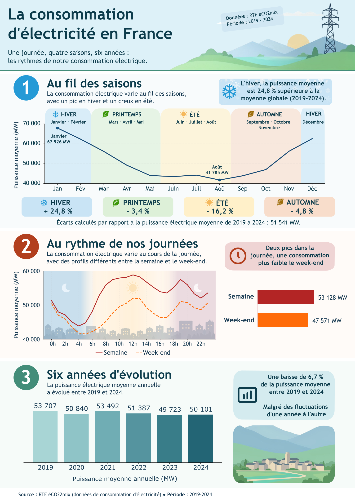

# Analyse de la consommation électrique en France (2019-2024)

Projet personnel de Data Analysis réalisé à partir des données publiques de RTE, dans le cadre d'une simulation de commande pour une association de vulgarisation scientifique et environnementale.

L'objectif est d'étudier les variations de la consommation électrique en France métropolitaine hors Corse, puis de présenter les principaux résultats dans une infographie accessible au grand public.





## 1. Objectifs du projet

L'analyse cherche à répondre à cinq questions : 

1. A quelles périodes de l'année la consommation électrique est-elle plus élevée ou la plus faible ?
2. Comment varie-t-elle au cours d'une journée ?
3. Quelles différences observe-t-on entre les saisons ?
4. Les profils de consommation diffèrent-ils entre la semaine et le week-end ?
5. Comment la consommation a-t-elle évolué entre 2019 et 2024 ?

Le projet couvre l'ensemble du processus, depuis la recherche et la vérification des données jusqu'à la création du livrable final.


## 2. Principaux résultats

L'analyse met notamment en évidence :

- Une forte saisonnalité : la puissance électrique moyenne est plus élevée en hiver et plus faible en été. L'hiver se situe à environ +24,8 % de la moyenne globale de la période.
- Deux pics au cours de la journée :  un premier autour de midi et un second en début de soirée.
- Une différence entre semaine et week-end : La puissance moyenne est de 53 128 MW en semaine, contre 47 571 MW le week-end, soit environ 10,46 % de moins.
- Une baisse entre 2019 et 2024 : La puissance moyenne annuelle passe de 53 707 MW à 50 101 MW, soit une diminution d'environ 6,7 %.
- Un minimum annuel en 2023 :  parmi les six années étudiées, 2023 présente la puissance moyenne annuelle la plus faible.

Les valeurs exprimées en MW correspondent à une puissance électrique moyenne appelée, et non directement à une quantité totale d'énergie consommée.


## 3. Démarche analytique

Une première source officielle, `Consommation quotidienne brute`, a été étudiée.

Les contrôles SQL ont révélé plusieurs anomalies temporelles, notamment en décembre 2020, 2022 et 2023. Ces anomalies introduisant une incertitude sur certaines observations, une autre source a été recherchée.

Le jeu de données `Données éCO2mix nationales consolidées et définitives`, publié par RTE, a finalement été retenu.

Des vérifications ont notamment porté sur la complétude journalière, les doublons, les valeurs extrêmes, la nature des données et les changements d'heure.

### Préparation des données

Les principales étapes ont été :

- Sélection des colonnes nécessaires à l'aide de Python et Pandas.
- Importation des données intermédiaires dans PostgreSQL.
- Sélection de la période 2019-2024.
- Suppression des observations sans mesure de consommation.
- Simplification de la structure et renommage des colonnes.
- Création de variables calendaires pour les analyses temporelles.

La table finale contient 105 216 observations, correspondant à 48 mesures de consommation par jour sur 2 192 journées.

### Analyse et visualisation

Les analyses descriptives ont été réalisées principalement en SQL, avec PostgreSQL.

Python, Pandas et Matplotlib ont ensuite été utilisés pour calculer les indicateurs nécessaires aux visualisations et produire les graphiques au format SVG.

L'infographie finale a été assemblée avec Inkscape. Certaines illustrations décoratives ont été générées avec Magnific AI et retouchées avec Krita.


## 4. Technologies utilisées

| Outil | Utilisations |
|---|---|
| PostgreSQL | Contrôles de qualité, préparation et analyses SQL |
| DBeaver | Gestion de la base et exécution des requêtes |
| Python | Préparation des données et visualisations |
| Pandas | Manipulation des données et calculs |
| Matplotlib | Création et export des graphiques |
| Inkscape | Composition pour l'infographie |
| Krita | Retouches graphiques |
| Magnific AI | Génération d'illustrations décoratives |

Environnement Python utilisé : Python 3.12.10


## 5. Organisation du dépôt

| Dossier / Fichier | Contenu |
|---|---|
| `assets/` | Icônes et illustrations utilisées dans l'infographie |
| `docs/` | Journal de projet détaillé au format PDF |
| `exports/` | Graphiques SVG générés avec Python |
| `inkscape/` | Fichier SVG modifiable de l'infographie |
| `livrable/` | Infographie finale au format PNG |
| `processed/` | Données intermédiaires et table d'analyse exportée |
| `python/` | Notebooks de préparation et de visualisation |
| `raw/` | Emplacement des fichiers de données brutes |
| `sql/ancienne_source/` | Scripts de contrôle de la première source étudiée |
| `sql/eco2mix/` | Scripts SQL de contrôle, de préparation et d'analyse |
| `requirements.txt` | Dépendances Python nécessaires au projet |
|`.gitignore` | Exclusion des fichiers locaux et temporaires |

Le journal disponible dans `docs/` détaille les contrôles effectués, les choix méthodologiques, les résultats et la réalisation de l'infographie.

## 6. Reproduction du projet

### Prérequis

- Python 3.12
- PostgreSQL
- Un outil permettant d'importer des CSV dans PostgreSQL, tel que DBeaver.
- Un environnement compatible avec les notebooks Jupyter, par exemple VS Code.

### Etape 1 - Récupérer les données

Deux sources publiques ont été étudiées :

Source principale : [RTE — Données éCO2mix nationales consolidées et définitives](https://www.data.gouv.fr/datasets/donnees-eco2mix-nationales-consolidees-et-definitives)

Fichier attendu dans raw/ : `eco2mix-national-cons-def.csv`

Première source étudiée : [ODRÉ — Consommation quotidienne brute](https://www.data.gouv.fr/datasets/consommation-quotidienne-brute)

Fichier attendu dans raw/ : `consommation-quotidienne-brute.csv`

Les fichiers bruts ne sont pas inclus dans le dépôt afin d'en limiter la taille. Ils peuvent être téléchargés depuis les sources officielles.

### Etape 2 - Installer les dépendances Python

Depuis la racine du projet, créer et activer un environnement virtuel :

```powershell
python -m venv .venv
.\.venv\Scripts\Activate.ps1
```

Installer les bibliothèques nécessaires :

```powershell
python -m pip install -r requirements.txt
```

### Etape 3 - Préparer le fichier pour PostgreSQL

Exécuter le notebook :

`python/01_preparation.ipynb`

Il sélectionne les six colonnes nécessaires dans le fichier brut éCO2mix et génère :

`processed/eco2mix_consommation.csv`

### Etape 4 - Importer et préparer les données dans PostgreSQL

1. Créer la table source à l'aide de `sql/eco2mix/01_creation_table_eco2mix.sql`.
2. Importer `processed/eco2mix_consommation.csv` dans cette table, en respectant les noms et types des colonnes.
3. Exécuter les scripts de contrôle de la source, numérotés de 02 à 08.
4. Créer la table de travail avec `01bis_creation_table_analyse.sql`.
5. Exécuter les scripts de préparation et de contrôle, numérotés de 09 à 16.
6. Exécuter les scripts d'analyse, numérotés de 17 à 24, y compris les variantes 20bis et 21bis si nécessaire.

Ces étapes sont prévues pour une base de données de travail ne contenant pas déjà les tables du projet.

Le fichier `processed/eco2mix_analyse.csv` correspond à l'export de la table finale préparée dans PostgreSQL. Il est également fourni pour permettre de consulter les résultats et d'exécuter directement les visualisations sans reconstruire toute la base.

### Etape 5 - Générer les graphiques

Exécuter le notebook : `python/02_visualisations.ipynb`

Il utilise `processed/eco2mix_analyse.csv` pour recalculer et afficher les graphiques de l'analyse. Les instructions d'export SVG sont présentes dans le notebook, mais commentées afin de préserver les fichiers définitifs disponibles dans `exports/`.

L'infographie complète, assemblée dans Inkscape, est disponible dans `livrable/`.


## 7. Limites de l'analyse

L'étude repose sur des moyennes descriptives et ne cherche pas à établir les causes des variations observées.

Les données agrègent plusieurs catégories d'usages électriques et ne permettent pas d'isoler la seule consommation des ménages.

Certaines particularités de représentation des horodatages subsistent lors des changements d'heure. Elles ont été identifiées pendant la préparation et conservées dans les données utilisées.

Enfin, les résultats portent uniquement sur la période 2019-2024 et sur le périmètre de la France métropolitaine hors Corse.


## 8. Livrables

- Infographie finale : [`livrable/infographie_consommation_electrique_2019_2024.png`](livrable/infographie_consommation_electrique_2019_2024.png)
- Journal de projet : [`docs/journal_analyse_consommation_electrique.pdf`](docs/journal_analyse_consommation_electrique.pdf)
- Notebooks Python : dossier [`python/`](python/)
- Scripts SQL : dossier [`sql/`](sql/)
- Données préparées : dossier [`processed/`](processed/)